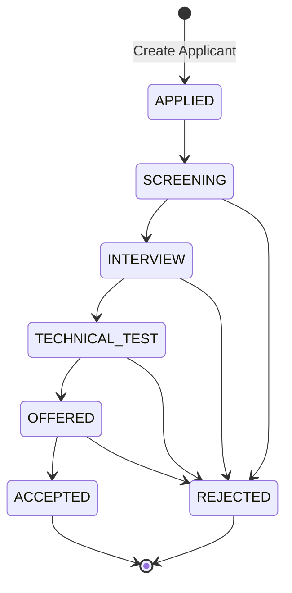

# Applicant Records RESTful API - Sekolah Karir

[](https://golang.org)
[](https://gin-gonic.com/)
[](https://gorm.io/)
[-003B57?style=flat&logo=sqlite)](https://github.com/glebarez/sqlite)
[](http://localhost:8080/swagger/index.html)
[](LICENSE)

Backend RESTful API untuk pengelolaan berkas dan proses rekrutmen pelamar kerja (*Applicant Records*), dirancang dan dibangun untuk **Mini Assignment Back-End Engineer Sekolah Karir Batch 2**.

---

## 📋 Informasi Kandidat & Pengumpulan

- **Nama Kandidat**: Lesmana Adh Kusuma
- **Applicant ID**: SKR26-0005
- **Posisi**: Back-End Engineer
- **Format Penamaan Submission**: `LesmanaAdhKusuma_BackEndEngineer_SKBatch2`
- **Form Pengumpulan**: [Google Form Submission](https://docs.google.com/forms/d/e/1FAIpQLSfkHJ4xtKuGU0tepeBsNO7ssOhxa7AFRTAh8Nph2QeHKt5H6g/viewform)

---

## 🎯 Ringkasan Solusi & Fitur Utama

API ini dibangun dengan fokus pada **kualitas reasoning**, **kejelasan arsitektur (clean design)**, serta **kemudahan eksekusi**:

1. **Create Applicant Record**:
   - Pendaftaran pelamar dengan validasi format email, nomor telepon, nama, dan posisi.
   - Pengecekan duplikasi email unik (mengembalikan status `409 Conflict`).
   - Otomatis meng-generate **UUID v4** untuk keamanan identifikasi (mencegah *ID enumeration / scraping*).
   - Inisialisasi tahapan default secara konsisten: `APPLIED`.
2. **List Applicants (Query, Filter & Search)**:
   - Dukungan **Pagination** (`page`, `limit`) dengan pagination metadata lengkap (`total_records`, `total_pages`, `page`, `limit`).
   - **Filter by Stage** (`stage=INTERVIEW`, `stage=APPLIED`, dll).
   - **Filter by Position** (`position=Back-End` - *case-insensitive substring match*).
   - **Keyword Search** (`search=lesmana` - mencakup kolom nama dan email).
3. **Update Applicant Stage**:
   - Pembaruan tahapan rekrutmen dengan validasi *Allowed Enum Stages*.
   - Pencatatan catatan/alasan perubahan tahap rekrutmen (*recruitment notes*).
   - Mengembalikan `400 Bad Request` jika stage di luar daftar enum yang diizinkan.
4. **Get Applicant Detail by ID**:
   - Pengambilan detail informasi pelamar berdasarkan UUID.
5. **System Health Check**:
   - Endpoint `/health` untuk liveness probe / monitoring status service.
6. **Dokumentasi Lengkap**:
   - **Interactive Swagger UI**: Tersedia langsung saat server berjalan di `/swagger/index.html`.
   - **Postman Collection v2.1**: Siap import di folder `postman/`.

---

## 🏗️ Desain & Arsitektur Sistem

Proyek ini mengadopsi **Clean / Layered Architecture** dengan *Dependency Injection* dan pemisahan tanggung jawab (*Separation of Concerns*):

```
sekolah-karir-mini-assigment/
├── cmd/
│   └── api/
│       └── main.go                 # Entrypoint aplikasi, inisialisasi router & dependency injection
├── config/
│   └── database.go                 # Konfigurasi SQLite CGO-free & AutoMigrate GORM
├── docs/                           # Swagger/OpenAPI generated files (swaggo)
│   ├── docs.go
│   ├── swagger.json
│   └── swagger.yaml
├── internal/
│   ├── handler/
│   │   ├── applicant_handler.go    # HTTP Controller, request binding, error mapping
│   │   └── applicant_handler_test.go # Integration tests untuk HTTP endpoints (httptest)
│   ├── model/
│   │   ├── applicant.go            # Entitas Domain & definisi Stage Enum
│   │   └── dto.go                  # Request/Response Data Transfer Objects (DTO)
│   ├── repository/
│   │   ├── applicant_repository.go # Data access layer (interface & implementasi GORM)
│   │   └── applicant_repository_test.go # Unit test layer database
│   └── service/
│       ├── applicant_service.go    # Business logic, validasi aturan bisnis, lifecycle
│       └── applicant_service_test.go # Unit test layer service
├── pkg/
│   └── response/
│       └── response.go             # Standarisasi JSON response envelope
├── postman/
│   └── SekolahKarir_Applicant_API.postman_collection.json # Postman Collection v2.1
├── .gitignore
├── go.mod
├── go.sum
└── README.md
```

### 1. Data Flow

```mermaid
flowchart LR
    Client([Client / Web / Mobile]) -->|HTTP Request| Handler[Handler Layer\n(Gin Controller)]
    Handler -->|Validate & DTO| Service[Service Layer\n(Business Logic)]
    Service -->|Domain Entity| Repository[Repository Layer\n(GORM SQLite)]
    Repository -->|SQL Queries| DB[(SQLite Database)]
```

### 2. Recruitment Stage Lifecycle

Tahapan rekrutmen (*Stages*) yang didukung:



Daftar Enum Stage:
- `APPLIED` *(Initial default)*
- `SCREENING`
- `INTERVIEW`
- `TECHNICAL_TEST`
- `OFFERED`
- `ACCEPTED`
- `REJECTED`

---

## 🛠️ Tech Stack & Keputusan Teknologi

| Komponen | Pilihan | Alasan Pemilihan |
|---|---|---|
| **Language** | Golang (Go 1.21+) | Kinerja tinggi, concurrency bawaan, type-safe, dan efisiensi memori. |
| **HTTP Framework** | Gin Web Framework | Performa tinggi (HttpRouter), middleware ecosystem luas, binding & validation terintegrasi. |
| **ORM** | GORM | Standar industri di ekosistem Go, mempermudah query building yang aman dari SQL injection, dan otomatis mengelola timestamps. |
| **Database** | SQLite (`glebarez/sqlite`) | Menggunakan driver **pure Go (CGO-free)**. Tidak membutuhkan C-compiler (MinGW/GCC) sehingga berjalan mulus di Windows, Linux, maupun macOS, sekaligus data tersimpan persisten secara lokal. |
| **Identifier** | UUID v4 (`google/uuid`) | Menghindari ID enumeration / scraping attacks pada data pelamar, aman untuk sistem berskala enterprise. |
| **API Documentation** | Swaggo (OpenAPI 3.0) + Postman | Penguji dapat langsung mencoba endpoint melalui web UI interaktif tanpa alat tambahan. |

---

## 🚀 Panduan Menjalankan Aplikasi

### Prasyarat:
- Pastikan telah menginstal [Go](https://go.dev/dl/) versi 1.21 ke atas.
  ```bash
  go version
  ```

### 1. Menjalankan Server API

Clone atau ekstrak repository, buka terminal di folder proyek, lalu jalankan:

```bash
# Menjalankan aplikasi
go run cmd/api/main.go
```

Output log pada terminal:
```text
[Database] Connected successfully to SQLite (applicants.db)
==================================================
 Applicant Records API is running on port 8080
 Swagger UI: http://localhost:8080/swagger/index.html
 Health Check: http://localhost:8080/health
==================================================
```

Server aktif di port `8080`. File database `applicants.db` akan dibuat secara otomatis.

---

### 2. Mengakses Dokumentasi Interaktif (Swagger UI)

Buka peramban (browser) dan akses:
👉 **[http://localhost:8080/swagger/index.html](http://localhost:8080/swagger/index.html)**

Dari halaman ini Anda dapat mengecek spesifikasi skema data serta menguji seluruh endpoint secara langsung (*Try it out*).

---

### 3. Mengimpor Postman Collection

1. Buka aplikasi **Postman**.
2. Klik tombol **Import**.
3. Pilih file: `postman/SekolahKarir_Applicant_API.postman_collection.json`.
4. Koleksi sudah dilengkapi dengan *pre-configured test script* yang secara otomatis menyimpan `applicant_id` baru ke dalam variable koleksi untuk mempermudah eksekusi request selanjutnya.

---

### 4. Menjalankan Automated Tests (Unit & Integration)

Pengujian mencakup unit test business logic pada service, operasi database repository, dan integrasi HTTP endpoint:

```bash
# Menjalankan semua test beserta rincian dan coverage
go test -v -cover ./...
```

Contoh output:
```text
PASS
coverage: 73.0% of statements
ok  	github.com/lesmana/sekolah-karir-applicant-api/internal/handler
PASS
coverage: 80.5% of statements
ok  	github.com/lesmana/sekolah-karir-applicant-api/internal/repository
PASS
coverage: 83.7% of statements
ok  	github.com/lesmana/sekolah-karir-applicant-api/internal/service
```

---

## 📖 Dokumentasi Endpoint & Contoh cURL

Format response standar mengadopsi struktur envelope yang konsisten:
- `success` (boolean): Menandakan status operasi.
- `message` (string): Pesan informatif.
- `data` (object/array): Payload hasil operasi.
- `meta` (object, opsional): Metadata paginasi.
- `errors` (array of string, opsional): Rincian kegagalan validasi.

---

### 1. Health Check
Memeriksa status ketersediaan service API.

- **Method**: `GET`
- **URL**: `/health`

```bash
curl -X GET http://localhost:8080/health
```

**Respon Sukses (200 OK)**:
```json
{
  "success": true,
  "message": "Service is healthy and ready to serve requests",
  "data": {
    "status": "UP"
  }
}
```

---

### 2. Create Applicant
Mendaftarkan applicant baru ke dalam sistem.

- **Method**: `POST`
- **URL**: `/api/v1/applicants`
- **Headers**: `Content-Type: application/json`

**Request Body**:
```bash
curl -X POST http://localhost:8080/api/v1/applicants \
  -H "Content-Type: application/json" \
  -d '{
    "name": "Lesmana Adh Kusuma",
    "email": "lesmana.adh@example.com",
    "phone": "081234567890",
    "applied_position": "Back-End Engineer",
    "notes": "Memiliki keahlian Golang, Gin, SQLite, dan RESTful Design"
  }'
```

**Respon Sukses (201 Created)**:
```json
{
  "success": true,
  "message": "Applicant created successfully",
  "data": {
    "id": "e81d89b1-0428-4e1b-8535-97e3f2824df9",
    "name": "Lesmana Adh Kusuma",
    "email": "lesmana.adh@example.com",
    "phone": "081234567890",
    "applied_position": "Back-End Engineer",
    "stage": "APPLIED",
    "notes": "Memiliki keahlian Golang, Gin, SQLite, dan RESTful Design",
    "created_at": "2026-11-12T19:30:00Z",
    "updated_at": "2026-11-12T19:30:00Z"
  }
}
```

**Respon Gagal - Validasi Input (400 Bad Request)**:
```json
{
  "success": false,
  "message": "Validation failed",
  "errors": [
    "field 'Name' is required",
    "field 'Email' must be a valid email address"
  ]
}
```

**Respon Gagal - Email Terdaftar (409 Conflict)**:
```json
{
  "success": false,
  "message": "applicant with this email already exists"
}
```

---

### 3. List Applicants (dengan Paginasi, Filter & Pencarian)
Mengambil daftar pelamar dengan opsi filtering dan pagination.

- **Method**: `GET`
- **URL**: `/api/v1/applicants`
- **Query Parameters**:
  - `page` (int, default: 1): Nomor halaman.
  - `limit` (int, default: 10, max: 100): Jumlah data per halaman.
  - `stage` (string, opsional): Filter stage (`APPLIED`, `INTERVIEW`, dll).
  - `position` (string, opsional): Filter substring posisi yang dilamar.
  - `search` (string, opsional): Pencarian kata kunci pada nama atau email.

**Contoh 1: Ambil data standar**:
```bash
curl -X GET "http://localhost:8080/api/v1/applicants?page=1&limit=10"
```

**Contoh 2: Filter stage INTERVIEW dan pencarian keyword**:
```bash
curl -X GET "http://localhost:8080/api/v1/applicants?stage=INTERVIEW&search=Lesmana"
```

**Respon Sukses (200 OK)**:
```json
{
  "success": true,
  "message": "Applicants retrieved successfully",
  "data": [
    {
      "id": "e81d89b1-0428-4e1b-8535-97e3f2824df9",
      "name": "Lesmana Adh Kusuma",
      "email": "lesmana.adh@example.com",
      "phone": "081234567890",
      "applied_position": "Back-End Engineer",
      "stage": "INTERVIEW",
      "notes": "Lolos screening CV, lanjut interview teknis",
      "created_at": "2026-11-12T19:30:00Z",
      "updated_at": "2026-11-12T19:35:00Z"
    }
  ],
  "meta": {
    "page": 1,
    "limit": 10,
    "total_records": 1,
    "total_pages": 1
  }
}
```

---

### 4. Get Applicant by ID
Mengambil data detail seorang pelamar berdasarkan ID.

- **Method**: `GET`
- **URL**: `/api/v1/applicants/:id`

```bash
curl -X GET http://localhost:8080/api/v1/applicants/e81d89b1-0428-4e1b-8535-97e3f2824df9
```

**Respon Sukses (200 OK)**:
```json
{
  "success": true,
  "message": "Applicant retrieved successfully",
  "data": {
    "id": "e81d89b1-0428-4e1b-8535-97e3f2824df9",
    "name": "Lesmana Adh Kusuma",
    "email": "lesmana.adh@example.com",
    "phone": "081234567890",
    "applied_position": "Back-End Engineer",
    "stage": "APPLIED",
    "notes": "Memiliki keahlian Golang",
    "created_at": "2026-11-12T19:30:00Z",
    "updated_at": "2026-11-12T19:30:00Z"
  }
}
```

**Respon Gagal - ID Tidak Ditemukan (404 Not Found)**:
```json
{
  "success": false,
  "message": "Applicant not found with the specified ID"
}
```

---

### 5. Update Applicant Stage
Memperbarui tahapan seleksi pelamar.

- **Method**: `PATCH`
- **URL**: `/api/v1/applicants/:id/stage`
- **Headers**: `Content-Type: application/json`

**Request Body**:
```bash
curl -X PATCH http://localhost:8080/api/v1/applicants/e81d89b1-0428-4e1b-8535-97e3f2824df9/stage \
  -H "Content-Type: application/json" \
  -d '{
    "stage": "INTERVIEW",
    "notes": "Lolos evaluasi teknis, dijadwalkan wawancara user"
  }'
```

**Respon Sukses (200 OK)**:
```json
{
  "success": true,
  "message": "Applicant stage updated successfully",
  "data": {
    "id": "e81d89b1-0428-4e1b-8535-97e3f2824df9",
    "name": "Lesmana Adh Kusuma",
    "email": "lesmana.adh@example.com",
    "phone": "081234567890",
    "applied_position": "Back-End Engineer",
    "stage": "INTERVIEW",
    "notes": "Lolos evaluasi teknis, dijadwalkan wawancara user",
    "created_at": "2026-11-12T19:30:00Z",
    "updated_at": "2026-11-12T19:40:00Z"
  }
}
```

**Respon Gagal - Stage Tidak Valid (400 Bad Request)**:
```json
{
  "success": false,
  "message": "Invalid recruitment stage. Allowed stages: [APPLIED SCREENING INTERVIEW TECHNICAL_TEST OFFERED ACCEPTED REJECTED]"
}
```

---

## 🤖 Catatan Penggunaan AI (AI & Tools Disclosure)

Sesuai ketentuan brief submission **Sekolah Karir**:
> *"Kamu boleh menggunakan AI tools, internet references, coding/design assistants, atau tools lain yang relevan. Jika menggunakan AI, tambahkan catatan singkat berisi tool yang digunakan dan bagaimana tool tersebut membantu."*

Berikut catatan keterbukaan penggunaan alat bantu selama pengerjaan assignment ini:

1. **Google Antigravity AI Assistant**:
   - Digunakan sebagai *collaborative thinking partner* melalui mekanisme interview terstruktur (`/grill-me` dan `/plan`) untuk membedah persyaratan teknis, mengeksplorasi trade-off arsitektur (misal: pemilihan driver SQLite CGO-free vs database/sql), dan merumuskan skema pengujian yang menyeluruh.
   - Membantu scaffolding boilerplate *Clean Architecture* di Go serta memastikan kepatuhan tag Swagger OpenAPI 3.0.
2. **Keterlibatan & Pemahaman Kandidat**:
   - Seluruh arsitektur, pemilihan model data, aturan tahapan rekrutmen, penanganan validasi, dan skenario pengujian dipahami secara mendalam oleh kandidat dan dapat dipresentasikan atau didiskusikan secara komprehensif pada tahap wawancara teknis.

---

## 📄 Lisensi

Proyek ini dibuat untuk keperluan seleksi kerja Sekolah Karir dan dilisensikan di bawah lisensi [MIT](LICENSE).
